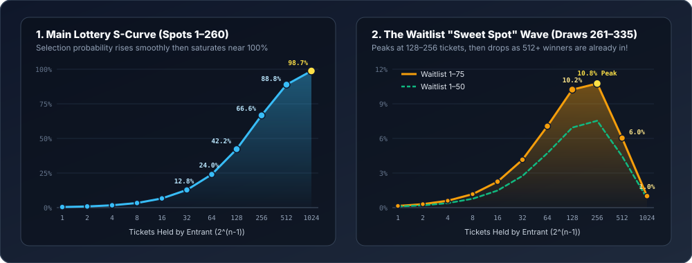
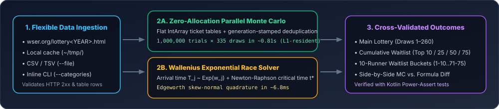

# Western States 100 (WSER) Lottery & Waitlist Probability Calculator


A high-performance Kotlin calculator that computes **exact** and **simulated** selection probabilities for the [Western States Endurance Run (WSER)](https://www.wser.org/) 100-mile lottery and waitlist.

---

## How the WSER Lottery & Waitlist Work

1. **Exponential Ticket Weighting**: An entrant with *n* consecutive years in the lottery receives 2<sup>*n*−1</sup> tickets (`1, 2, 4, 8, ..., 1024`).
2. **Sampling Without Replacement of Athletes**: Tickets are drawn one at a time uniformly at random from the hat. When an athlete's ticket is drawn:
   - That athlete claims the next available spot.
   - All remaining (*k* − 1) tickets belonging to that same athlete are **ignored** (effectively removed) for the remainder of the draw.
3. **Main Lottery & Waitlist**:
   - The first **260** unique athletes drawn win a spot in the **Main Lottery**.
   - The next **50 to 75** unique athletes drawn (draw positions `261` through `335`) are placed in order on the **Waitlist**.



---

## Dual-Solver Architecture



This project implements two independent methods to compute selection probabilities and cross-validates them against each other:

### 1. Zero-Allocation Parallel Monte Carlo Simulator (`Main.kt`)
* **Flat Primitive Lookup Tables**: Pre-maps every ticket index `[0, totalTickets)` into two contiguous `IntArray` tables (`ticketToAthleteId` and `ticketToCategoryIdx`) to eliminate object pointer chasing.
* **Generation-Stamped Deduplication**: Each worker coroutine maintains a thread-local `IntArray(totalAthletes)` storing the simulation index at which an athlete was already selected, avoiding `HashSet` allocations or array clearing between trials.
* **L1-Cache-Resident Rank Accumulator**: Tracks wins across every exact draw rank (`0 until 335`) and ticket category in a `29 KB` `LongArray`, enabling instant slicing of the Main Lottery (`1..260`), cumulative waitlist thresholds (`1..10`, `1..25`, `1..50`, `1..75`), and 10-runner waitlist buckets (`1-10`, `11-20`, ..., `71-75`).
* **Performance**: Runs **1,000,000 full lottery + waitlist trials** (~335 unique runners drawn per trial) in **~0.81 seconds** on Apple Silicon.

### 2. Analytical Solver via Wallenius' Noncentral Hypergeometric Distribution (`GemSolver2.kt`)
* **Why Simple Hypergeometric Formulas Fail**: Treating non-winning tickets as static ignores that high-ticket runners are disproportionately selected early, removing all of their duplicate tickets from the hat and increasing the effective odds of lower-ticket runners in later draws.
* **Exponential Race Representation**: Models each athlete *j* with *w*<sub>*j*</sub> tickets as having an independent arrival time *T*<sub>*j*</sub> ~ Exponential(*w*<sub>*j*</sub>). Selecting *M* unique athletes without replacement is mathematically identical to selecting the *M* athletes with the smallest arrival times *T*<sub>*j*</sub>.
* **Continuity-Corrected Edgeworth Integration**: Uses Newton-Raphson to locate the critical time *t*\* where the expected number of prior winners is *M* − 0.5, then integrates the conditional survival distribution across [*t*\* − 8σ<sub>*t*</sub>, *t*\* + 8σ<sub>*t*</sub>] in **~6.8 ms**.

---

## Getting Started

### Prerequisites
* **JDK 21** (configured via Gradle `jvmToolchain(21)`)

### Run for the Current Year (Default)
When invoked with no arguments, the program targets the **current calendar year** (`https://www.wser.org/lottery<YEAR>.html`, cached at `~/tmp/lottery<YEAR>.html`):
```bash
./gradlew run
```

### Target a Specific Year via CLI
Pass either a 4-digit year positional argument or `--year <year>` (`-y <year>`):
```bash
./gradlew run --args="2027"
# or
./gradlew run --args="--year 2026"
```

### Force a Fresh Download from `wser.org`
To bypass the local HTML cache (`~/tmp/lottery<year>.html`) and fetch the latest entrant counts:
```bash
./gradlew run --args="2027 --force-download"
```

### Alternate Ways to Provide Ticket Count Data
If a given year's lottery page has not been published on `wser.org` yet or you want to evaluate custom distributions, you can supply ticket counts directly without fetching from `wser.org`:

1. **From a local CSV / TSV / whitespace-delimited or HTML file (`--file` / `--input`)**:
   ```bash
   ./gradlew run --args="--file path/to/tickets.csv"
   ```
   Each line specifies `<tickets>,<entrants>` (with `<total>` optional; `#` comments and header rows are ignored):
   ```csv
   Tickets,Entrants
   1024,1
   512,7
   256,46
   128,94
   64,175
   32,342
   16,511
   8,778
   4,998
   2,1435
   1,1717
   ```

2. **Inline on the command line (`--categories`)**:
   ```bash
   ./gradlew run --args="--categories 1024:1,512:7,256:46,128:94,64:175,32:342,16:511,8:778,4:998,2:1435,1:1717"
   ```

### Customize the Number of Monte Carlo Trials (`--trials`)
```bash
./gradlew run --args="2027 --trials 500000"
```

### Run Unit Tests (with Kotlin Power-Assert)
The test suite uses the [Kotlin Power-Assert compiler plugin](https://kotlinlang.org/docs/power-assert.html) to verify CLI parsing, HTML/CSV/inline category parsing, error reporting, boundary invariants, exact small-pool probabilities, waitlist rank conservation, and convergence between the Monte Carlo engine and the analytical Wallenius solver:
```bash
./gradlew test
```

---

## License

Licensed under the [MIT License](LICENSE).
